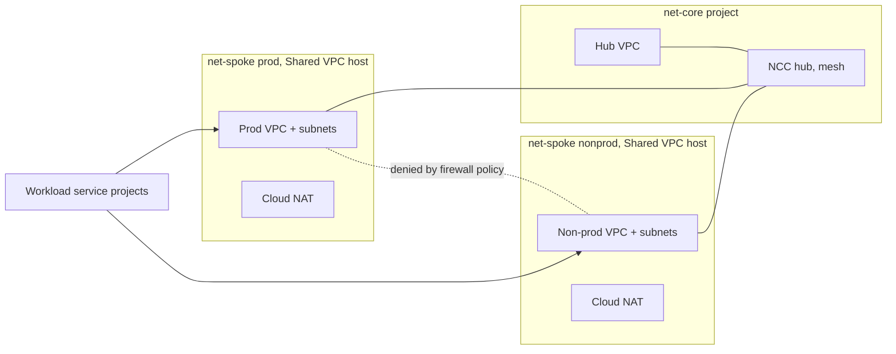

# gcp-infrastructure-lz

Trust level: **High**. This repository owns the network every workload runs on. A bad change here can cut connectivity for every project, so every change goes through a pull request, two reviewers (one a code owner) and a human approval before apply.

It builds the hub-and-spoke network on top of the foundation from `gcp-foundation-bootstrap`:

| Stage | Creates |
|---|---|
| [`1-network-hub`](1-network-hub/) | Hub VPC, baseline firewall policy, private DNS zone, DNS response policy and the Network Connectivity Center (NCC) hub, in the hub project (`<prefix>-pr-net-core`) created by bootstrap stage `2-network-projects` |
| [`2-network-spokes`](2-network-spokes/) | VPC, subnets, proxy-only subnet, Private Service Access, firewall policy, Cloud NAT, DNS peering, the NCC spoke attachment, and attachment of every workload project, in the Shared VPC hosts (`<prefix>-prod-net-spoke`, `<prefix>-non-prod-net-spoke`) created by that same stage |

Workload projects themselves are created by `gcp-foundation-bootstrap` (stage `4-workload-projects`). This repository reads that list and attaches them to the right Shared VPC, and grants each workload's deployer `roles/compute.networkUser` on the spoke subnets.

Module code comes from `gcp-terraform-module` (vendored Cloud Foundation Fabric **v59.1.0**), pinned by tag.



## How a change flows

```text
feature branch ─▶ terraform workflow, in order:
                  fmt, tflint, validate, checkov, drift, plan
             ──▶ 2 approvals, one from a code owner, signed commits, linear history
main, manual  ─▶ Actions → terraform → apply
                  (repeats those stages, then apply after the production approval)
every night   ─▶ drift (opens an issue when Google Cloud differs from main)
```

## Requirements

Same toolchain as `gcp-foundation-bootstrap`: Terraform `1.16.6` (`.terraform-version`), providers `google` and `google-beta` `~> 8.5`, pre-commit (mandatory, `make hooks`), tflint, terraform-docs `>= 0.24`, checkov `3.3.30`, Go for the hook toolchain.

## Order of work

1. `gcp-foundation-bootstrap` must be fully applied first, **including** `4-workload-projects` (this repository reads its outputs) and `2-network-projects` (this repository builds networks in those projects and does not create them).
2. Copy each stage's `terraform.tfvars.example` to `terraform.tfvars`, replace `REPLACE_ME` and `000000000000`, and reserve the ranges in [docs/ip-plan.md](docs/ip-plan.md). Do not commit `terraform.tfvars`.
3. `make set-org ORG=<github-org>`, `make hooks`, then open a PR. No human ever applies from a workstation here.

## GitHub configuration

| Kind | Name | Value |
|---|---|---|
| Variable | `WIF_PROVIDER` | Output `workload_identity_provider_name` of bootstrap stage `3-cicd-identity` |
| Variable | `TF_SA` | Output `automation_service_accounts.execute` of bootstrap stage `0-core-projects` |
| Variable | `TF_STATE_BUCKET` | Output `state_buckets.lz` of bootstrap stage `0-core-projects` |
| Variable (optional) | `RUNNER_LABELS` | JSON list, for example `["self-hosted","cicd-runners"]` |
| Secret | `MODULES_READ_TOKEN` | Read-only credential for `gcp-terraform-module` |
| Environment | `production` | Required reviewers, `main` only. `make protect` creates it. |

## Cross-repository contract

Reads output `projects` from bootstrap state prefix `bootstrap/3-workload-projects` (directory `4-workload-projects`; bucket in `bootstrap_state_bucket`). The hub and Shared VPC host project ids come from `gcp-terraform-module/modules/naming`, the same module the bootstrap stages use. Those projects are created by bootstrap stage `2-network-projects` under the Network folder. Renaming an output, that state prefix, or a network project id is a breaking change that needs a coordinated PR here.

## Not in this repository yet

- **HA VPN and Interconnect** to on-premises (the diagram's VPN). The vendored library has `net-vpn-ha` and `net-vlan-attachment`; add them to `1-network-hub` when a real peer, ASN and shared secret process exist. See [ADR 0003](docs/adr/0003-vpn-and-interconnect-deferred.md).
- **Centralized egress inspection** (Cloud NGFW, secure web proxy).
- **VPC Service Controls.** The DNS response policy uses `private.googleapis.com` (`199.36.153.8/30`). A perimeter would change that to `restricted.googleapis.com`.

## Repository layout

```text
.github/             workflows, composite action, CODEOWNERS, rulesets, templates, dependabot
1-network-hub/       stage: hub VPC, NCC hub, in the bootstrap hub project
2-network-spokes/    stage: spoke VPCs, firewall, NAT, NCC spokes, service project attachment
config/stages.txt    apply order, read by the workflows
docs/                ip plan, controls, ADRs
scripts/             changed-stages, offline validation, branch protection, set-org
```
